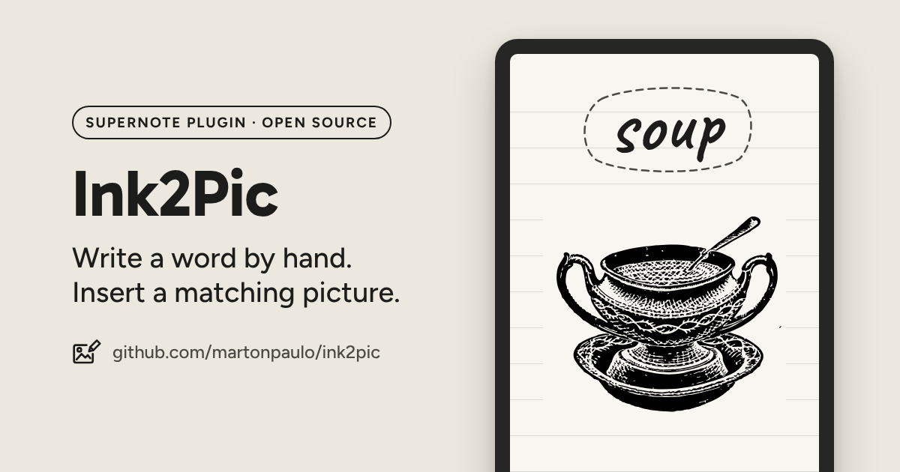
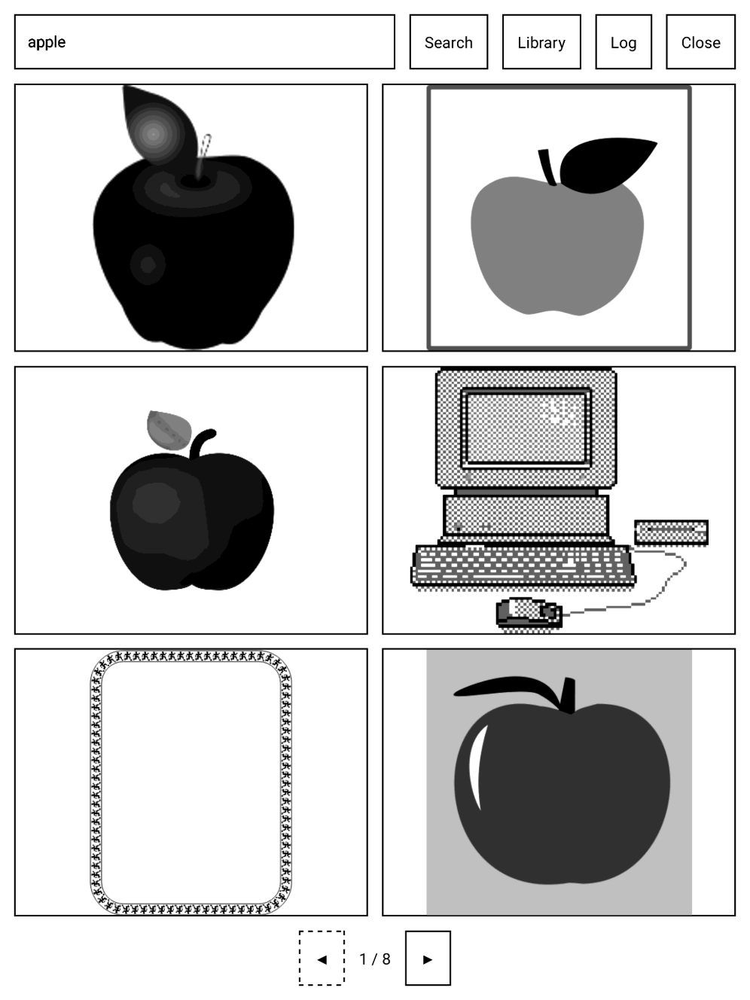
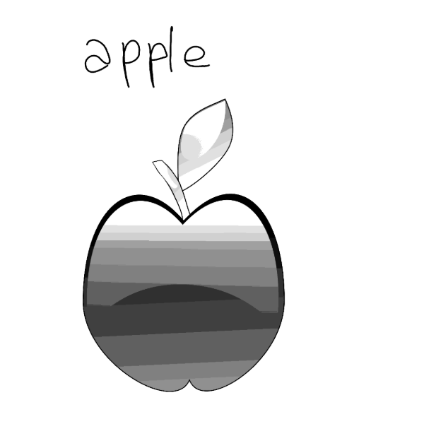
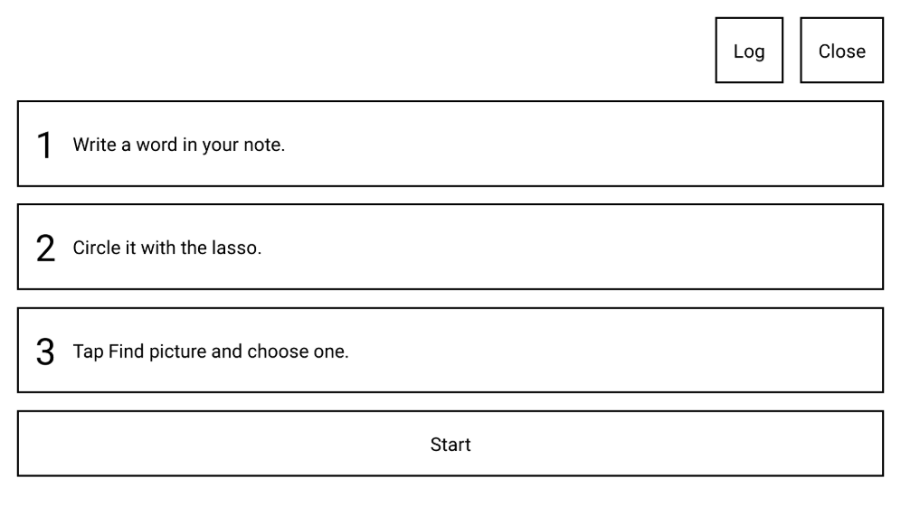

# Ink2Pic

Write a word by hand on your Supernote, lasso it, and insert a matching picture from Openclipart or Wikimedia Commons. Keyless, no phone needed.

**[Download Ink2Pic](https://github.com/martonpaulo/ink2pic/releases)**

> [!NOTE]
> Ink2Pic is in development. The only builds are **test builds** (GitHub prereleases). There is no
> stable release yet.

## Why Ink2Pic

Ink2Pic is a **Supernote plugin** that puts **a picture of a real thing** into your note: soup, a
tree, an apple, a historical person. **Write the word, lasso it, tap Find picture, and tap the
picture you want.** Ink2Pic searches **clip art** on Openclipart and pictures on Wikimedia Commons,
and puts the one you choose **just below your word**. The picture is **already converted for the
e-ink screen**. You need **no account, no key and no phone**.

  
  &nbsp;
  

Left: the results for a handwritten «apple». Right: the note after one tap. Screens from a Supernote Manta; the note page is cropped to the word and the picture.

## Requirements

- A Supernote Manta with firmware Chauvet 3.31.45 or newer.
- Internet access on the device, to search.

Ink2Pic is tested on the Manta only. The Supernote Nomad is not tested.

## Install

Each test build is a GitHub prerelease named `v0.1.0-dev.<number>`, with the file `Ink2Pic.snplg`
attached.

1. Open the [releases page](https://github.com/martonpaulo/ink2pic/releases) and download
   `Ink2Pic.snplg` from the newest prerelease, the one at the top.
2. Copy the file to the `MyStyle` folder of your Manta, with the Supernote Partner app, a USB
   cable, Browse & Access or Supernote Cloud.
3. On the device, open **Settings > Apps > Plugins > Add Plugin** and pick `Ink2Pic.snplg`.
4. To update, do the same with the new file: use **Add Plugin** and pick it. When the release
   notes say a build changes native code, restart the device after the update.

## Use it

1. Write a word in English in a note.
2. Circle it with the lasso.
3. In the lasso toolbar, tap **Find picture**. It can be in the **⋯** menu of that toolbar.
4. Tap the picture you want. Ink2Pic puts it just below your word and closes.

The results come six per page; tap ◀ and ▶ for more. If the device read the word wrong, fix it in
the search field and tap **Search**. Your handwritten word stays in the note.

You can also open Ink2Pic from the **Plugins** button of the note toolbar. It then opens an empty
search: type a word and tap **Search**.

### The first time

The first screen shows the three steps. Tap **Start**, and the device asks for each permission
Ink2Pic needs. Choose **Always Allow**, or the device asks again each time you open Ink2Pic.

### Library

Ink2Pic keeps every picture you insert. Tap **Library** to see them and tap one to insert it again.
The Library also works with no internet, and shows your recent search words as buttons.

Ink2Pic never deletes your files. Builds before 0.1.0 (13) also kept a `*.source.*` copy of each
picture in `MyStyle/Ink2Pic/library/`; you can delete those copies with the file manager.

### Log

Tap **Log** to see what Ink2Pic did, step by step. Ink2Pic also writes the log to files on the
device, in `MyStyle/Ink2Pic/logs/`.

## Permissions

Ink2Pic asks for three permissions. In **Settings > Apps > Plugins > Ink2Pic > Permissions** they
are named as in the first column.

| Permission | Why |
| :--- | :--- |
| Network Access | To search Openclipart, Wikimedia Commons and Wikidata, and to get the picture you choose. |
| Read Files | To read your saved pictures and the log in `MyStyle/Ink2Pic/`. |
| Modify Files | To save each picture you insert in `MyStyle/Ink2Pic/library/`, and the log in `MyStyle/Ink2Pic/logs/`. |

If a permission is off, Ink2Pic names the missing one on its first screen and tells you where to
turn it on.

## When something does not work

Ink2Pic never fails silently: it shows one sentence that says what to do.

| You see | What to do |
| :--- | :--- |
| «No internet. Showing your library.» | Connect to Wi-Fi, or insert a picture you saved before. |
| «Ink2Pic needs internet access to search pictures.» | Turn on Network Access in Settings > Apps > Plugins > Ink2Pic > Permissions. |
| «Could not read the word. Type it instead.» | Type the word in the search field and tap Search. |
| «No pictures found. Check the spelling or try one word.» | Check the spelling, or try one word or a more common one. |
| «Could not put the picture in the note. Open a note page and try again.» | Open a page of a note, lasso the word again and try again. |
| «Something went wrong. Open Log for details.» | Tap Log, then report the problem as below. |

### Report a problem

1. Copy the folder `MyStyle/Ink2Pic/logs/` from the device, with the Supernote Partner app or USB.
   `session.log` is the latest use, `session.prev.log` the one before, and `crash.log` exists only
   after a crash.
2. Open an [issue](https://github.com/martonpaulo/ink2pic/issues) with your device, the firmware,
   the Ink2Pic build (for example `v0.1.0-dev.12`), what you did, and the log files.

## Privacy

Ink2Pic sends only the searched word, and only to Openclipart, Wikimedia Commons and Wikidata,
which names the word's typical pictures on Commons. The device reads your handwriting itself; your
notes never leave the device. Ink2Pic has no account, no server and no analytics.

## Picture sources and licenses

Every picture comes from one of two sites. Ink2Pic records the source, the license and the
attribution of each picture it saves.

| Source | License |
| :--- | :--- |
| [Openclipart](https://openclipart.org/) | CC0 1.0: free to use, no attribution needed |
| [Wikimedia Commons](https://commons.wikimedia.org/) | The license of each file, recorded with the picture with its attribution |

## Limitations

- English search words only.
- Tested on the Manta only; the Nomad is not tested.
- The picture goes just below the word. Move it or resize it with the Supernote's own lasso.
- Only test builds exist; there is no stable release yet.

## For developers

Setup, commands and the device test protocol are in [`CONTRIBUTING.md`](CONTRIBUTING.md). The
product definition and the technical brief are in [`docs/`](docs/).

## License and credits

[MIT](LICENSE) © 2026 Marton Paulo.

Pictures come from Openclipart (CC0) and Wikimedia Commons (license per file, recorded with each
picture).

Third-party notices are in [`NOTICE.md`](NOTICE.md).
